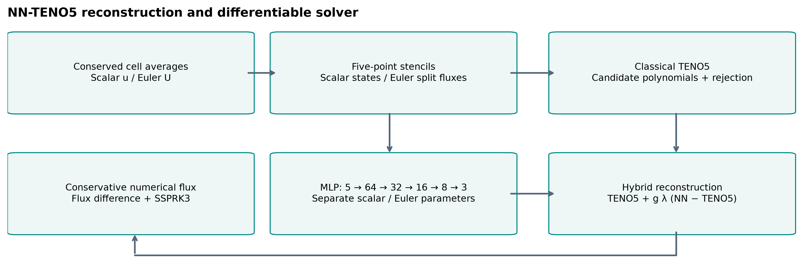

# Neural shock capturing with NN-TENO5

**A reproducible research investigation of neural corrections to high-order PDE solvers.**

Can a small neural network sharpen discontinuities without damaging smooth-flow
accuracy, conservation, or stability? This internship project implements classical
and neural WENO/TENO solvers, a differentiable JAX training pipeline, and numerical
experiments that test that question for scalar conservation laws and 1D Euler flow.

The results are mixed. Modest **soft** neural corrections help on the short-horizon
validation corpus. Larger corrections can fail, hard decisions perform differently,
and long-time benefits depend on the problem. A broader smooth Euler test also
exposes a second-order finite-volume consistency limitation in the historical solver.



## Method

We solve `U_t + F(U)_x = 0` using a conservative numerical-flux difference and
SSPRK3 time integration. Problems include linear advection, inviscid Burgers, and
ideal-gas Euler with γ=1.4. TENO5 supplies candidate reconstructions and a
smoothness-based acceptance decision. Neural reconstruction changes candidate
weights; a separate deterministic gate decides whether that correction is used:

$$
\hat f_{hybrid}=\hat f_{TENO5}+g_i\lambda(\hat f_{NN}-\hat f_{TENO5}),\qquad
 g_i=\mathbf{1}\{\text{at least one TENO candidate rejected}\}.
$$

If TENO accepts every candidate, the hybrid returns its classical reconstruction.
The gate is a detector, **not a proof of fifth-order accuracy or stability**.
For scalar equations, reconstruction acts on states before an LF numerical flux;
for historical Euler, it acts on characteristic positive/negative split fluxes.

Two independently trained MLPs share the architecture **5 → 64 → 32 → 16 → 8 → 3**:

- **Scalar:** advection and Burgers, its own parameters/checkpoint.
- **Euler:** characteristic reconstruction, its own parameters/checkpoint.

Soft candidate weights and hard candidate masks are distinct policies. Correction
strength λ is distinct from both candidate selection and the deterministic gate.
Historical P0 learned blends remain separately named and reproducible.

## Training and data

Training differentiates through **15 SSPRK3 steps**, comparing predicted states
against analytic reference cell averages. The V2 pipeline uses a state error and
scalar TV penalty, or an Euler positivity penalty with an optional historical repair.
That repair is **not conservative**; evaluation is unguarded unless explicitly labeled.
The earlier four-term unrolled-loss research remains in the historical documentation.

The [V2 corpus](data/nnteno_v2/README.md) contains **6,144 independent mathematical PDE
trajectories**, with 64/128/256 cells, four stored reference times and a matched
short-horizon target. It contains **no experimental flow measurements**. References
are analytic solutions evaluated as cell averages, using closed forms or quadrature
split at known wave boundaries.

The original test split was already examined. It is historical evidence and is
excluded from new policy selection. This release uses all **615 scalar + 307 Euler
validation trajectories**, followed by predeclared prospective benchmark cases.

## Measured validation results

Selected inference policy: **deterministic gate + soft candidates, λ=0.25** for
both existing checkpoints. No network weights were changed for this study.

| Full validation, 15 steps | Macro L1 / TENO5 | 95% bootstrap interval | Invalid trajectories |
|---|---:|---:|---:|
| Scalar, λ=.25 soft | **0.9770** | 0.9742–0.9788 | 0 / 615 |
| Euler, λ=.25 soft | **0.9479** | 0.9436–0.9523 | 0 / 307 |
| Scalar, original λ=.75 soft | 1.0464 | See full report | 0 / 615 |
| Euler, λ=1 soft | 1.1643† | See full report | 1 / 307 |

Macro averages give each nonconstant family×resolution equal weight. Constants
and nearly zero baseline errors are excluded from ratios; absolute errors remain
reported. Intervals use paired, stratified bootstrap resampling across trajectories.
†The failed setting's statistic conditions on valid trajectories and cannot select
an accepted method. These are **validation-selected**, short-horizon findings.
They are not universal performance or independent-test claims.


[Full numerical report](docs/research_release/RESULTS.md) ·
[Per-case validation data](docs/research_release/results/full-validation/per_case.json) ·
[Uncertainty and groups](docs/research_release/results/full-validation/summary.json) ·
[Independent benchmark](configs/v2/independent.json)

## Accuracy, conservation and limitations

- Zero correction strength reproduces TENO5; regression tests check interface
  reconstruction, full rollouts, and parity with the original V2 evaluator.
- Regular smooth advection and Euler entropy-wave **spatial** errors approach fifth
  order. Critical-point results differ; spatial and SSPRK3 time errors are reported
  separately. Neural-only reconstruction approaches third order on these tests.
- General nonlinear smooth Euler cell averages expose approximately **second-order**
  behavior in the historical split-flux solver. An optional finite-volume state-flux
  variant measures approximately fifth-order spatial consistency on that test;
  its shock behavior, training, and positivity remain unvalidated.
- Stage positivity, effective CFL, physical boundary exchange, conservation budgets,
  extrema, oscillations and total variation are measured. The strong-correction
  repair study shows explicit mass/energy changes; repaired results are not
  promoted to successful unguarded trajectories.
- Long-time comparisons are problem-dependent. Numerical Burgers, Shu–Osher and
  blast-wave references carry grid/timestep uncertainty; failed references remain
  failures. The frozen P0 Shu–Osher caveats remain in force.
- The selected V2 method fails the closed-wall interacting-blast stress test at
  both 128 and 256 cells; TENO5 stays admissible. Full-time blast accuracy is
  unassessed. Fine temporal controls through 640 and the original finest blast
  reference were stopped for CPU cost; completed time controls reach 160 cells.
- One training seed per original V2 network; no multi-seed training robustness or
  experimental validation. Input-distribution diagnostics do not prove a causal
  benefit from changing warm-up. No universal speedup or positivity theorem.


## Computational cost

Isolated AMD Ryzen 5 4600H CPU, float64, median of nine warmed trajectory runs;
compilation is measured separately. These examples show **added cost**, not a speedup:

| Matched 512-cell IVP | TENO5 time | Gated-soft time | Gated / TENO5 L1 |
|---|---:|---:|---:|
| Advection, T=.5 | .1115 s | 1.2134 s | 1.079 |
| Sod, T=.17 | .9607 s | 2.5280 s | .954 |

[Full timing and equal-budget comparisons](docs/research_release/results/performance/performance.json)
include four grids, hard/neural-only policies, compilation and memory estimates.
The measured grid ladder does not establish a cheaper neural route to the same
accuracy. GPU timing and general speedups are not demonstrated.

## Reproduce on CPU

Use Python 3.11 in a separate environment from the original TensorFlow/Keras work:

```bash
python3.11 -m venv .venv
. .venv/bin/activate
python -m pip install -r requirements-v2.txt
export JAX_PLATFORMS=cpu
export MPLCONFIGDIR=/tmp/nn-teno5-matplotlib
python -m pytest src/differentiable/tests -q
python -m src.differentiable.research sweep --config configs/v2/smoke.json --output /tmp/v2-smoke-new
python -m src.differentiable.research sweep --config configs/v2/full.json --output /tmp/v2-full-new
```

Every output directory must be new. Full studies are explicit local commands, not
CI workloads. See [the reproduction guide](docs/research_release/REPRODUCE.md) for
convergence, input-distribution, repair, long-time, timing, figure and artifact checks.
The evaluation environment and checkpoint/data hashes are recorded with results.
The validated execution path is Linux CPU/float64. For a separate optional GPU
environment, follow the [official JAX installation guide](https://docs.jax.dev/en/latest/installation.html)
for compatible drivers and CUDA wheels; GPU execution has not been verified here.

## Navigate the project

| Path | Purpose |
|---|---|
| `src/differentiable/` | JAX solvers, strict checkpoint loading, explicit inference policies, evaluation and studies |
| `configs/v2/` | Smoke/full validation, frozen selected policy, prospective benchmark definitions |
| `docs/research_release/` | Audit, baseline provenance, milestone record, numerical results and reproduction |
| `docs/portfolio/` | Reproducible figures, LinkedIn drafts, carousel, video storyboard and CV material |
| `data/nnteno_v2/` | Canonical exact-reference corpus, generator, loader and QA |
| `models/v2/` | Preserved independent scalar/Euler checkpoints and historical reports |
| `src/core/`, `src/schemes/` | Original NumPy numerical solver and WENO/TENO schemes |
| `Documentation/` | Historical phases, proposal implementation guide and frozen P0 validation |

The duplicate `data/data/` corpus is preserved for compatibility. Its eight files
match the canonical copy by hash. New work should use `data/nnteno_v2/data/`;
see the [migration recommendation](docs/research_release/REPRODUCE.md).
The [previous README](README_P0_ARCHIVE.md) retains legacy usage and
historical results. No P0 results or historical checkpoints were overwritten.

## Credits

**Yasser BAOUZIL:** solver extensions, differentiable JAX implementation, training
integration, experiments and research software in this repository. The internship
supervisor **Radouan BOUKHARFANE** proposed the unrolled physics-loss research
direction and supplied numerical-method clarifications. See the
[contribution statement](docs/portfolio/CONTRIBUTIONS.md).

The original WENO-NN foundation and accompanying code are by **Ben Stevens and
Tim Colonius**, [*Enhancement of shock-capturing methods via machine learning*](https://authors.library.caltech.edu/records/1xdr6-8n320).
TENO foundations are by **Lin Fu, Xiangyu Hu and Nikolaus Adams**,
[*A family of high-order targeted ENO schemes*](https://portal.fis.tum.de/en/publications/a-family-of-high-order-targeted-eno-schemes-for-compressible-flui/).
These foundational algorithms and the supervisor's proposal are not claimed as
student inventions. Distributed under the [MIT license](LICENSE).
