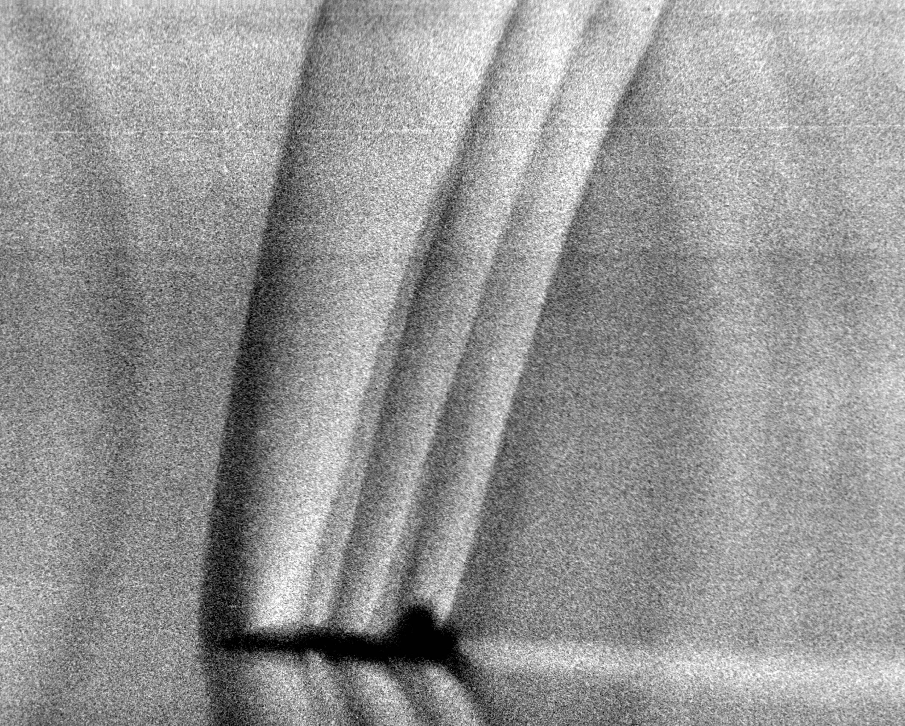
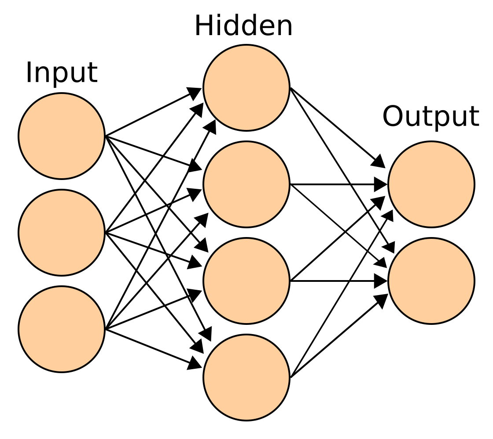
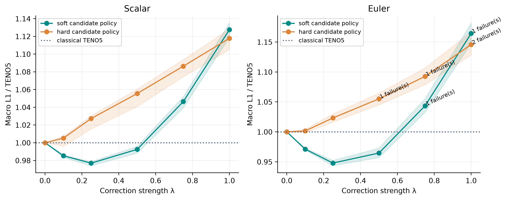
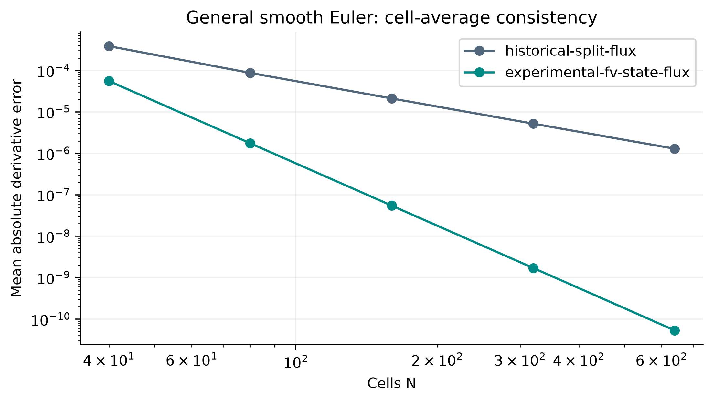

# Neural shock capturing with NN-TENO5

**A reproducible research investigation of neural corrections to high-order PDE solvers.**

Can a small neural network sharpen discontinuities without damaging smooth-flow
accuracy, conservation, or stability? This internship project implements classical
and neural WENO/TENO solvers, a differentiable JAX training pipeline, and numerical
experiments that test that question for scalar conservation laws and 1D Euler flow.

<p align="center">
  
</p>

*Real shock waves around a T-38 jet, photographed by Leonard Weinstein / NASA
This photograph motivates the problem; the experiments below solve 1D mathematical
PDEs and do not simulate this aircraft or use the photograph as training data.*

The results are mixed. Modest **soft** neural corrections help on the short-horizon
validation corpus. Larger corrections can fail, hard decisions perform differently,
and long-time benefits depend on the problem. A broader smooth Euler test also
exposes a second-order finite-volume consistency limitation in the historical solver.

[Method and input vectors](#method-from-cell-averages-to-the-next-time-step) ·
[Training equations](#how-the-two-networks-are-trained) ·
[Measured results](#measured-validation-results) · [Reproduction](#reproduce-on-cpu)

## The problem: resolve shocks without losing smooth-flow accuracy

Shocks are abrupt changes in a flow. A numerical solver must resolve them while
controlling artificial oscillations and excessive smearing. We study conservation
laws and their finite-volume update:

```math
\frac{\partial U}{\partial t}+\frac{\partial F(U)}{\partial x}=0,
\qquad
\frac{d\bar U_i}{dt}
=-\frac{\hat F_{i+1/2}-\hat F_{i-1/2}}{\Delta x}.
```

Here $`\bar U_i`$ is a cell average and $`\hat F_{i+1/2}`$ is the numerical flux between
cells. The scalar problems use $`U=u`$, with $`F(u)=au`$ for linear advection or
$`F(u)=u^2/2`$ for inviscid Burgers. For compressible Euler flow,

```math
U=\begin{pmatrix}
\rho \\
\rho v \\
E
\end{pmatrix},\qquad
F(U)=\begin{pmatrix}
\rho v \\
\rho v^2+p \\
v(E+p)
\end{pmatrix},\qquad
p=(\gamma-1)\left(E-\frac{\rho v^2}{2}\right),\quad\gamma=1.4.
```

Density $`\rho`$, velocity $`v`$, pressure $`p`$, and total energy density $`E`$ describe
the flow. The research question is whether learned reconstruction can improve
discontinuity resolution while retaining accuracy and physical consistency.

## Method, from cell averages to the next time step

The following describes the **V2 deterministic-gate baseline** implemented in
[the JAX solver](src/differentiable/). Scalar and Euler reconstruction use the
same candidate formulas and MLP architecture, but different input quantities and
independently trained parameters.

```text
Current cell averages
  |
  +-- Scalar: five state values, forward and mirrored
  `-- Euler: Roe projection -> LF splitting -> five values per field/sign
                              |
                +-------------+------------------+
                |                                |
         Classical TENO5                 Normalize each stencil
         candidates P_k                 Scalar NN or Euler NN
         smoothness beta_k                       |
         acceptance chi_k               3 candidate discard scores
                |                                |
           R_TENO, gate g                 keep weights -> R_NN
                +----------------+---------------+
                                 |
                   R_hybrid = R_TENO + g*lambda*(R_NN - R_TENO)
                                 |
                   Conservative numerical interface flux
                                 |
                   Flux difference -> three SSPRK3 stages
                                 |
                          Next cell averages
```

### 1. Normalize the five-value input vector

Write a raw reconstruction stencil as a row vector
$`\mathbf z=(z_0,z_1,z_2,z_3,z_4)`$. Only the neural branch normalizes it:

```math
\mathbf X=\nu(\mathbf z)
=\frac{\mathbf z-z_{\min}\mathbf 1}{r_{\mathrm{safe}}},\qquad
z_{\min}=\min_j z_j,\quad r=\max_j z_j-z_{\min},\quad
r_{\mathrm{safe}}=\begin{cases}
r,&r>0,\\
1,&r=0.
\end{cases}
```

A constant stencil therefore gives $`\mathbf X=\mathbf 0`$. The safe denominator
also prevents an inactive division by zero from poisoning automatic differentiation.
Classical smoothness indicators and candidate values are computed on **raw**
$`\mathbf z`$; the MLP receives $`\mathbf X\in\mathbb R^5`$.

### 2. First network: scalar-state inputs

For the interface $`x_{i+1/2}`$, the scalar model receives these two normalized
stencils of cell averages:

```math
\begin{aligned}
\mathbf X_{\mathrm s,i+1/2}^{L}
&=\nu\!\left(\bar u_{i-2},\bar u_{i-1},\bar u_i,\bar u_{i+1},\bar u_{i+2}\right),\\
\mathbf X_{\mathrm s,i+1/2}^{R}
&=\nu\!\left(\bar u_{i+3},\bar u_{i+2},\bar u_{i+1},\bar u_i,\bar u_{i-1}\right).
\end{aligned}
```

The right stencil is centered on cell $`i+1`$ and reversed for reconstruction from
the other side. **One scalar network** serves both directions and both advection
and Burgers. The physical speed, timestep and PDE flux are handled by the solver;
each network call has exactly five inputs. V2 scalar training uses periodic boundaries.

### 3. Second network: Euler characteristic split-flux inputs

The Euler network also has five inputs per call. To construct them, start from
$`\bar U_j=(\rho_j,m_j,E_j)^T`$, with $`m_j=\rho_jv_j`$ and
$`H_j=(E_j+p_j)/\rho_j`$. At interface $`i+1/2`$, form the Roe averages

```math
\widetilde v=
\frac{\sqrt{\rho_i}v_i+\sqrt{\rho_{i+1}}v_{i+1}}
{\sqrt{\rho_i}+\sqrt{\rho_{i+1}}},\qquad
\widetilde H=
\frac{\sqrt{\rho_i}H_i+\sqrt{\rho_{i+1}}H_{i+1}}
{\sqrt{\rho_i}+\sqrt{\rho_{i+1}}},\qquad
\widetilde a=\sqrt{(\gamma-1)(\widetilde H-\widetilde v^2/2)}.
```

Use one frozen eigenbasis across the stencil:

```math
R_{i+1/2}=\begin{pmatrix}
1&1&1\\
\widetilde v-\widetilde a&\widetilde v&\widetilde v+\widetilde a\\
\widetilde H-\widetilde v\widetilde a&\widetilde v^2/2&\widetilde H+\widetilde v\widetilde a
\end{pmatrix},\qquad L_{i+1/2}=R_{i+1/2}^{-1}.
```

For each cell in the stencil, project the state and flux, then apply
Lax–Friedrichs splitting:

```math
\mathbf w_j=L_{i+1/2}\bar U_j,\qquad
\boldsymbol\varphi_j=L_{i+1/2}F(\bar U_j),\qquad
\boldsymbol\varphi_j^{\pm}
=\tfrac12(\boldsymbol\varphi_j\pm\alpha_{i+1/2}\mathbf w_j),
```

```math
\alpha_{i+1/2}=\max_{j\in\{i,i+1\}}(|v_j|+a_j),\qquad
a_j=\sqrt{\gamma p_j/\rho_j}.
```

The **actual Euler input vectors** for characteristic field $`c\in\{1,2,3\}`$ are

```math
\begin{aligned}
\mathbf X_{\mathrm e,c,i+1/2}^{+}
&=\nu\!\left(\varphi^+_{i-2,c},\varphi^+_{i-1,c},\varphi^+_{i,c},
\varphi^+_{i+1,c},\varphi^+_{i+2,c}\right),\\
\mathbf X_{\mathrm e,c,i+1/2}^{-}
&=\nu\!\left(\varphi^-_{i+3,c},\varphi^-_{i+2,c},\varphi^-_{i+1,c},
\varphi^-_{i,c},\varphi^-_{i-1,c}\right).
\end{aligned}
```

**One Euler network** is reused for all three fields and both flux signs. The
batched arrays have shape `(interfaces, 3 fields, 5 values)` for each sign.
The physical components $`\rho,m,E`$ enter through projection and splitting;
the five neural inputs are neighboring values of a single characteristic split flux.
See [the exact extraction routine](src/differentiable/euler_jax.py).

### 4. Two MLPs, with independent parameters

<p align="center">
  
</p>

*Conventional feed-forward network illustration by Cburnett, drawn in Inkscape
(2006). [Source](https://commons.wikimedia.org/wiki/File:Artificial_neural_network.svg),
[CC BY-SA 3.0](https://creativecommons.org/licenses/by-sa/3.0/); rendered on white
for readability in light and dark themes.
This generic illustration shows layer connectivity; our exact architecture is below.
[Image credits](docs/readme/IMAGE_CREDITS.md).*

```text
Scalar: X_s [5] -> [64 ReLU] -> [32 ReLU] -> [16 ReLU] -> [8 ReLU] -> [3 sigmoid]
Euler:  X_e [5] -> [64 ReLU] -> [32 ReLU] -> [16 ReLU] -> [8 ReLU] -> [3 sigmoid]
        separate scalar parameters theta_s and Euler parameters theta_e
```

For either parameter set $`\theta\in\{\theta_{\mathrm s},\theta_{\mathrm e}\}`$,

```math
\mathbf h_0=\mathbf X,\qquad
\mathbf h_\ell=\mathrm{ReLU}(\mathbf h_{\ell-1}W_\ell+\mathbf b_\ell),
\quad\ell=1,\ldots,4,\qquad
\mathcal N_\theta(\mathbf X)=\sigma(\mathbf h_4W_5+\mathbf b_5).
```

Here $`\mathrm{ReLU}(z)=\max(0,z)`$ and $`\sigma(z)=(1+e^{-z})^{-1}`$ act
componentwise. In the implementation's row-vector convention,

```math
W_1\in\mathbb R^{5\times64},\quad W_2\in\mathbb R^{64\times32},\quad
W_3\in\mathbb R^{32\times16},\quad W_4\in\mathbb R^{16\times8},\quad
W_5\in\mathbb R^{8\times3}.
```

Including biases gives **3,155 trainable parameters per model**. Their outputs are

```math
\mathbf q_{\mathrm s}^{L/R}=\mathcal N_{\theta_{\mathrm s}}(\mathbf X_{\mathrm s}^{L/R}),
\qquad
\mathbf q_{\mathrm e,c}^{\pm}=\mathcal N_{\theta_{\mathrm e}}(\mathbf X_{\mathrm e,c}^{\pm}),
\qquad\mathbf q=(q_0,q_1,q_2)\in[0,1]^3.
```

Each $`q_k`$ is a **candidate-discard score** for one of the three TENO substencils.
These are independent sigmoid outputs; they need not sum to one. The V2 backbones
have no learned correction-strength head. Parameter shapes and activations are
implemented in [the MLP](src/differentiable/teno5_jax_toy.py) and checked by
[the checkpoint loader](src/differentiable/model_io.py).

### 5. Classical TENO5 candidates and deterministic smoothness detection

For any raw five-value stencil $`\mathbf z`$, both classical and neural branches
combine the same three candidate values:

```math
\begin{aligned}
P_0(\mathbf z)&=\tfrac13z_0-\tfrac76z_1+\tfrac{11}{6}z_2,\\
P_1(\mathbf z)&=-\tfrac16z_1+\tfrac56z_2+\tfrac13z_3,\\
P_2(\mathbf z)&=\tfrac13z_2+\tfrac56z_3-\tfrac16z_4,
\qquad \mathbf d=(0.1,0.6,0.3).
\end{aligned}
```

The Jiang–Shu smoothness indicators are

```math
\begin{aligned}
\beta_0&=\tfrac{13}{12}(z_0-2z_1+z_2)^2+\tfrac14(z_0-4z_1+3z_2)^2,\\
\beta_1&=\tfrac{13}{12}(z_1-2z_2+z_3)^2+\tfrac14(z_1-z_3)^2,\\
\beta_2&=\tfrac{13}{12}(z_2-2z_3+z_4)^2+\tfrac14(3z_2-4z_3+z_4)^2.
\end{aligned}
```

TENO5 computes

```math
\tau_5=|\beta_0-\beta_2|,\quad
\eta_k=\left(1+\frac{\tau_5}{\beta_k+\varepsilon}\right)^6,\quad
\chi_k=\frac{\eta_k}{\sum_{j=0}^2\eta_j},\quad
\delta_k=\mathbf{1}\{\chi_k\ge C_T\},\qquad
\varepsilon=10^{-40},\quad C_T=10^{-5}.
```

The code evaluates the normalized selection values in log space for numerical
robustness. Accepted candidates receive renormalized optimal weights:

```math
\mathcal R_{\mathrm{TENO}}(\mathbf z)
=\frac{\sum_{k=0}^2 d_k\delta_kP_k(\mathbf z)}{\sum_{k=0}^2 d_k\delta_k}.
```

### 6. Neural candidate weights and the deterministic correction gate

Convert the model's output into either soft weights or a hard mask:

```math
\kappa_k^{\mathrm{soft}}=1-q_k,\qquad
\kappa_k^{\mathrm{hard}}=\mathbf{1}\{q_k<0.5\},\qquad
D=\sum_{k=0}^2d_k\kappa_k.
```

The neural reconstruction and hybrid are

```math
\mathcal R_{\mathrm{NN}}(\mathbf z)
=\begin{cases}
\displaystyle\frac{\sum_{k=0}^2d_k\kappa_kP_k(\mathbf z)}{D},&D>0,\\
z_2,&D=0,
\end{cases}
\qquad
g=\mathbf{1}\{\min_k\chi_k<C_T\}=1-\prod_{k=0}^2\delta_k,
```

```math
\boxed{\mathcal R_{\mathrm{hybrid}}
=\mathcal R_{\mathrm{TENO}}
+g\lambda(\mathcal R_{\mathrm{NN}}-\mathcal R_{\mathrm{TENO}})},\qquad
0\le\lambda\le1.
```

Thus $`g=0`$ returns classical TENO5 whenever all candidates are accepted. The
network supplies $`\mathbf q`$, TENO supplies $`g`$, and fixed $`\lambda`$ controls
correction amplitude. For Euler, this decision is applied separately to each
field and split-flux sign. Setting $`\lambda=0`$ reproduces TENO5, which regression
tests check. **The gate alone proves neither fifth-order accuracy nor stability.**
Historical learned-blend methods and optional learned-strength variants remain
separately named in [the reconstruction API](src/differentiable/reconstruction.py).

### 7. Assemble one numerical flux per interface

For scalar equations, reconstruct $`u^L=\mathcal R_{\mathrm{hybrid}}(\mathbf z^L)`$
and $`u^R=\mathcal R_{\mathrm{hybrid}}(\mathbf z^R)`$, then evaluate

```math
\hat f_{i+1/2}=\tfrac12\left[f(u^L)+f(u^R)-\alpha(u^R-u^L)\right].
```

The implemented dissipation is $`\alpha=|a|`$ for advection and
$`\alpha=\max(\max_i|\bar u_i|,0.01)`$ for Burgers, recomputed at each RK stage.
For the historical Euler split-flux solver,

```math
\widehat\varphi_c^{\pm}
=\mathcal R_{\mathrm{hybrid}}(\mathbf z_{f,c}^{\pm}),\qquad
\hat F_{i+1/2}=R_{i+1/2}
\left(\widehat{\boldsymbol\varphi}^{+}+\widehat{\boldsymbol\varphi}^{-}\right).
```

V2 Euler training uses transmissive boundaries: stencil indices are clamped at
the domain edges, the left boundary flux is $`F(\bar U_0)`$, and the right boundary
uses the reconstructed flux. With a shared interface flux, the semidiscrete
conservation budget telescopes:

```math
\frac{d}{dt}\left(\Delta x\sum_i\bar U_i\right)
=-\left(\hat F_{\mathrm{right}}-\hat F_{\mathrm{left}}\right).
```

It vanishes for periodic boundaries. Positivity repairs can add a separate
conservation defect. Also, historical Euler evaluates $`F(\bar U_j)`$ before
reconstruction; $`F(\bar U_j)\ne\overline{F(U)}_j`$ in general. The measured smooth
consistency limitation and optional state-flux variant are reported below.

### 8. Advance with SSPRK3

Let $`\mathcal{L}_\theta(U)_i=-(\hat{F}_{i+1/2}-\hat{F}_{i-1/2})/\Delta x`$.
One full timestep consists of three stages:

```math
\begin{aligned}
U^{(1)}&=U^n+\Delta t\,\mathcal L_\theta(U^n),\\
U^{(2)}&=\tfrac34U^n+\tfrac14\left[U^{(1)}+\Delta t\,\mathcal L_\theta(U^{(1)})\right],\\
U^{n+1}&=\tfrac13U^n+\tfrac23\left[U^{(2)}+\Delta t\,\mathcal L_\theta(U^{(2)})\right].
\end{aligned}
```

Stencils, projections, gate decisions and neural outputs are recomputed at every
stage. Training uses each trajectory's recorded $`\Delta t_b`$ and physical speed;
the effective CFL $`\Delta t_b\max\alpha/\Delta x`$ can evolve as the state changes.

## How the two networks are trained

### Exact-reference trajectories and separate data splits

The [V2 corpus](data/nnteno_v2/README.md) contains **6,144 independent mathematical
PDE trajectories** on $`N\in\{64,128,256\}`$ cells over $`[0,1]`$, so $`\Delta x=1/N`$.
It contains **no experimental flow measurements**. Targets are analytic solution
cell averages, using closed forms or quadrature split at known wave boundaries:

```math
\bar U_{b,i}^{\star}(T_b)
=\frac1{\Delta x}\int_{x_{i-1/2}}^{x_{i+1/2}}U_b^{\mathrm{exact}}(x,T_b)\,dx,
\qquad T_b=K\Delta t_b,\qquad K=15.
```

Each trajectory stores four reference times and a separate short-horizon target.
The loss uses the initial state and that matched target: **15 full SSPRK3 steps,
or 45 internal stages**. These references are not point samples.

| Model | Training trajectories | Validation trajectories | Historical test trajectories |
|---|---:|---:|---:|
| Scalar | 2,867 | 615 | 614 |
| Euler | 1,434 | 307 | 307 |

Immutable trajectory IDs and file hashes guard split integrity. The training
routine opens train/validation files; testing is a separate command. The original
test split has since been examined and is excluded from further model selection.

### Stage A: supervised warm-up from deterministic TENO decisions

For each training stencil, TENO supplies the keep labels
$`y_k=\delta_k=\mathbf{1}\{\chi_k\ge C_T\}`$. The model predicts
$`k_k=1-q_k`$. With $`\widetilde k_k=\mathrm{clip}(k_k,10^{-7},1-10^{-7})`$,
warm-up minimizes weighted binary cross-entropy:

```math
\mathcal L_{\mathrm{warm}}
=-\frac1{3B}\sum_{b=1}^{B}\sum_{k=0}^2
w_{b,k}\left[y_{b,k}\log\widetilde k_{b,k}
+(1-y_{b,k})\log(1-\widetilde k_{b,k})\right],\qquad
w_{b,k}=\begin{cases}
2,&y_{b,k}=0,\\
1,&y_{b,k}=1.
\end{cases}
```

The pool samples up to 12 initial trajectories per family and resolution, caps
the raw pool at 15,000 stencils, and balances stencils with a rejected candidate
against all-accepted stencils when both are available. Warm-up runs 150 Adam
updates with batches of 256 stencils and global gradient clipping at 1.

**Euler warm-up input differs from solver input in the saved V2 runs.** The
historical warm-up used normalized forward characteristic **state** stencils,

```math
\mathbf X_{\mathrm e,c}^{\mathrm{warm}}
=\nu\!\left((L_{i+1/2}\bar U_{i-2})_c,\ldots,
(L_{i+1/2}\bar U_{i+2})_c\right).
```

Physics training and inference use the split-flux vectors from step 3. An explicit
`--pretraining-inputs split-flux` ablation now extracts the actual solver inputs;
the preserved checkpoints were not retrained with that option. See the
[input-distribution diagnostic](docs/research_release/results/input-mismatch-r2/input_mismatch.json).

### Stage B: differentiate through the numerical trajectory

After warm-up, use the **soft candidate policy** and the deterministic gate inside
the solver. For each initial condition, integrate

```math
U_\theta^{K}=\Phi_{\theta,\Delta t}^{K}(U^0),\qquad
\nabla_\theta\mathcal L
=\frac{\partial\mathcal L}{\partial U_\theta^K}
\frac{\partial\Phi_{\theta,\Delta t}^{K}}{\partial\theta}
+\text{gradients of trajectory penalties}.
```

JAX differentiates through candidate weighting, numerical fluxes and the 15-step
SSPRK3 rollout, implemented with `lax.scan` and batched with `vmap`. The hard TENO
comparisons contribute zero derivatives; AD follows the selected branches. Thus
the computational graph is piecewise differentiable. The V2 objective uses the
terminal reference error plus the following penalties. At a fixed stencil,

```math
\left.\frac{\partial\mathcal R_{\mathrm{hybrid}}}{\partial\theta}\right|_{\mathbf z}
=g\lambda\frac{\partial\mathcal R_{\mathrm{NN}}}{\partial\theta}.
```

An inactive gate therefore removes the direct local neural gradient; gate
decisions can still change as states evolve through the rollout. The earlier four-term
unrolled-loss proposal remains documented in
[the historical guide](Documentation/UNROLLED_PHYSICS_LOSS_GUIDE.md).

**Scalar loss.** For a batch of $`B`$ trajectories with $`N`$ cells, define a separate
reference scale per trajectory and periodic total variation:

```math
s_b=\max\!\left(\frac1N\sum_i(u_{b,i}^{\star})^2,0.05\right),\qquad
\mathrm{TV}(u)=\sum_i|u_i-u_{i-1}|,\qquad [z]_+=\max(z,0).
```

```math
\boxed{\mathcal L_{\mathrm s}
=\frac1{BN}\sum_{b,i}\frac{(u_{\theta,b,i}^{K}-u_{b,i}^{\star})^2}{s_b}
+\frac{0.05}{BN}\sum_b
\left[\mathrm{TV}(u_{\theta,b}^{K})-\mathrm{TV}(u_b^0)\right]_+}.
```

The TV term penalizes excess final variation above the initial profile; it does
not enforce a TVD theorem or penalize every intermediate stage.

**Euler loss.** Normalize each conserved component across the batch and cells:

```math
s_c=\max\!\left(\frac1{BN}\sum_{b,i}(U_{b,i,c}^{\star})^2,0.05\right),
\qquad c\in\{\rho,m,E\}.
```

Let $`V_b^{n,r}`$ be the tentative state **before repair** at RK stage $`r`$ of step
$`n`$. The implemented objective is

```math
\boxed{\mathcal L_{\mathrm e}
=\frac1{3BN}\sum_{b,i,c}\frac{(U_{\theta,b,i,c}^{K}-U_{b,i,c}^{\star})^2}{s_c}
+\frac{0.1}{BK}\sum_{b=1}^{B}\sum_{n=0}^{K-1}\sum_{r=1}^3
\mathcal P(V_b^{n,r})}.
```

The positivity term sums capped violation depths over cells:

```math
\mathcal P(V)=\sum_i\left[\min([-\rho_i]_+,10^3)
+\min([-p_i^{\mathrm{safe}}]_+,10^3)\right],\qquad
p_i^{\mathrm{safe}}=(\gamma-1)
\left[E_i-\tfrac12\rho_i(m_i/\rho_{i,\mathrm{safe}})^2\right],
```

where $`\rho_{i,\mathrm{safe}}=\rho_i`$ for positive density and 1 otherwise.
Nonfinite rows are replaced by $`(-1,0,1)`$ before this penalty is evaluated.
The penalty is divided by $`K`$, **not** by the number of stages or cells, matching
the actual implementation.

During Euler training, every tentative stage is then passed through the
historical repair $`U^{n,r}=\mathcal G(V^{n,r})`$: isolated invalid cells are
replaced by neighbor averages; remaining invalid/out-of-scale cells use density
and pressure floors/caps (0.05 to 1,000) and a velocity cap of 50. Neighbor
selection is periodic even though the solver uses transmissive boundaries.
**This repair is not conservative or a proved positivity-preserving scheme.**
Checkpoint selection and standard evaluation run without it; dedicated release
diagnostics measure every stage and account for any repair-induced conservation loss.

### Sampling, optimization and checkpoint selection

Each physics model is trained separately. A minibatch has one resolution and
one family; resolutions are sampled uniformly and families use these probabilities:

| Scalar family | Probability | Euler family | Probability |
|---|---:|---|---:|
| Constant | .04 | Constant | .08 |
| Square wave | .22 | Contact | .18 |
| Fourier | .18 | Random Riemann | .38 |
| Gaussian | .12 | Sod-like | .19 |
| Smooth Burgers | .22 | Two rarefactions | .17 |
| Burgers top-hat | .22 | — | — |

The physics loss gradient is clipped before the Adam update:

```math
g_t=\nabla_\theta\mathcal L(\theta_t),\qquad
\widetilde g_t=\frac{g_t}{\max(1,\|g_t\|_2)},\qquad
\theta_{t+1}=\mathrm{AdamUpdate}(\theta_t,\widetilde g_t;\eta=2\times10^{-4}).
```

Initialization uses He-scaled weights $`W_{ab}\sim\mathcal N(0,2/n_{\mathrm{in}})`$
and zero biases. Warm-up and physics training use separate optimizer states.
The same initialization seed, 2026, was used for both saved models; each model
then receives its own physics-specific updates. This is one run per physics,
not evidence of robustness across training seeds.

| Saved V2 setting | Scalar | Euler |
|---|---:|---:|
| Architecture / parameters | 5–64–32–16–8–3 / 3,155 | 5–64–32–16–8–3 / 3,155 |
| Fixed correction strength **during training** | .75 | .25 |
| Warm-up updates / batch size | 150 / 256 | 150 / 256 |
| Physics-update budget / trajectory batch size | 300 / 8 | 300 / 8 |
| Learning rate | .0002, constant | .0002, constant |
| Saved best physics-update index (zero-based) | 280 | 299 |
| Fixed checkpoint-selection cases | 36 | 30 |

The original selection reused **two validation trajectories per family and
resolution**, checking every 20 updates and at the final update. With group
MAE $`E_{\theta,g}`$, its score was

```math
S_{\mathrm{old}}(\theta)=\frac1G\sum_{g=1}^{G}
\frac{E_{\theta,g}+10^{-8}}{E_{\mathrm{TENO},g}+10^{-8}},\qquad
G=18\text{ (scalar) or }15\text{ (Euler)}.
```

Only finite, physically admissible **unguarded** validation predictions can save
a best checkpoint. Improvement must exceed $`10^{-5}`$; eight unsuccessful checks
trigger early stopping. The newer release instead evaluates **all 615 scalar +
307 Euler validation trajectories**, reports per-trajectory distributions and
bootstrap intervals, and excludes constant/near-zero-error baselines from ratios.
These are different evaluation protocols. The later choice $`\lambda=.25`$ for
both models changes inference strength only; **it does not retrain either model**.

The executable training equations are in
[Train_Gated_NNTENO5_Dataset_V2.py](scripts/unrolled_physics_loss/Train_Gated_NNTENO5_Dataset_V2.py).
Exact run settings, model identity and selection histories are preserved with the
[scalar checkpoint](models/v2/scalar_gated_dataset_v2_seed2026.json) and
[Euler checkpoint](models/v2/euler_gated_dataset_v2_seed2026.json).

## Measured validation results

Selected inference policy: **deterministic gate + soft candidates, λ=0.25** for
both existing checkpoints. No network weights were changed for this study.

| Full validation, 15 steps | Macro L1 / TENO5 | 95% bootstrap interval | Invalid trajectories |
|---|---:|---:|---:|
| Scalar, λ=.25 soft | **0.9770** | 0.9742–0.9788 | 0 / 615 |
| Euler, λ=.25 soft | **0.9479** | 0.9436–0.9523 | 0 / 307 |
| Scalar, original λ=.75 soft | 1.0464 | See full report | 0 / 615 |
| Euler, λ=1 soft | 1.1643† | See full report | 1 / 307 |

Macro averages give each nonconstant family×resolution equal weight. Constants
and nearly zero baseline errors are excluded from ratios; absolute errors remain
reported. Intervals use paired, stratified bootstrap resampling across trajectories.
†The failed setting's statistic conditions on valid trajectories and cannot select
an accepted method. These are **validation-selected**, short-horizon findings.
They are not universal performance or independent-test claims.



[Full numerical report](docs/research_release/RESULTS.md) ·
[Per-case validation data](docs/research_release/results/full-validation/per_case.json) ·
[Uncertainty and groups](docs/research_release/results/full-validation/summary.json) ·
[Independent benchmark](configs/v2/independent.json)

## Accuracy, conservation and limitations

- Zero correction strength reproduces TENO5; regression tests check interface
  reconstruction, full rollouts, and parity with the original V2 evaluator.
- Regular smooth advection and Euler entropy-wave **spatial** errors approach fifth
  order. Critical-point results differ; spatial and SSPRK3 time errors are reported
  separately. Neural-only reconstruction approaches third order on these tests.
- General nonlinear smooth Euler cell averages expose approximately **second-order**
  behavior in the historical split-flux solver. An optional finite-volume state-flux
  variant measures approximately fifth-order spatial consistency on that test;
  its shock behavior, training, and positivity remain unvalidated.
- Stage positivity, effective CFL, physical boundary exchange, conservation budgets,
  extrema, oscillations and total variation are measured. The strong-correction
  repair study shows explicit mass/energy changes; repaired results are not
  promoted to successful unguarded trajectories.
- Long-time comparisons are problem-dependent. Numerical Burgers, Shu–Osher and
  blast-wave references carry grid/timestep uncertainty; failed references remain
  failures. The frozen P0 Shu–Osher caveats remain in force.
- The selected V2 method fails the closed-wall interacting-blast stress test at
  both 128 and 256 cells; TENO5 stays admissible. Full-time blast accuracy is
  unassessed. Fine temporal controls through 640 and the original finest blast
  reference were stopped for CPU cost; completed time controls reach 160 cells.
- One training seed per original V2 network; no multi-seed training robustness or
  experimental validation. Input-distribution diagnostics do not prove a causal
  benefit from changing warm-up. No universal speedup or positivity theorem.



## Computational cost

Isolated AMD Ryzen 5 4600H CPU, float64, median of nine warmed trajectory runs;
compilation is measured separately. These examples show **added cost**, not a speedup:

| Matched 512-cell IVP | TENO5 time | Gated-soft time | Gated / TENO5 L1 |
|---|---:|---:|---:|
| Advection, T=.5 | .1115 s | 1.2134 s | 1.079 |
| Sod, T=.17 | .9607 s | 2.5280 s | .954 |

[Full timing and equal-budget comparisons](docs/research_release/results/performance/performance.json)
include four grids, hard/neural-only policies, compilation and memory estimates.
The measured grid ladder does not establish a cheaper neural route to the same
accuracy. GPU timing and general speedups are not demonstrated.

## Reproduce on CPU

Use Python 3.11 in a separate environment from the original TensorFlow/Keras work:

```bash
python3.11 -m venv .venv
. .venv/bin/activate
python -m pip install -r requirements-v2.txt
export JAX_PLATFORMS=cpu
export MPLCONFIGDIR=/tmp/nn-teno5-matplotlib
python -m pytest src/differentiable/tests -q
python -m src.differentiable.research sweep --config configs/v2/smoke.json --output /tmp/v2-smoke-new
python -m src.differentiable.research sweep --config configs/v2/full.json --output /tmp/v2-full-new
```

To train fresh scalar and Euler backbones with the documented historical budgets,
use distinct run names. These commands retain the original training strengths:

```bash
python scripts/unrolled_physics_loss/Train_Gated_NNTENO5_Dataset_V2.py \
  --physics scalar --data-root data/nnteno_v2 --seed 2026 --strength .75 \
  --run-name scalar_reproduction_seed2026
python scripts/unrolled_physics_loss/Train_Gated_NNTENO5_Dataset_V2.py \
  --physics euler --data-root data/nnteno_v2 --seed 2026 --strength .25 \
  --run-name euler_reproduction_seed2026
```

The script refuses an existing checkpoint name. The Euler split-flux warm-up
ablation requires another fresh name and `--pretraining-inputs split-flux`.
Fresh training runs have not been executed for this documentation update.

Every output directory must be new. Full studies are explicit local commands, not
CI workloads. See [the reproduction guide](docs/research_release/REPRODUCE.md) for
convergence, input-distribution, repair, long-time, timing, figure and artifact checks.
The evaluation environment and checkpoint/data hashes are recorded with results.
The validated execution path is Linux CPU/float64. For a separate optional GPU
environment, follow the [official JAX installation guide](https://docs.jax.dev/en/latest/installation.html)
for compatible drivers and CUDA wheels; GPU execution has not been verified here.

## Navigate the project

| Path | Purpose |
|---|---|
| `src/differentiable/` | JAX solvers, strict checkpoint loading, explicit inference policies, evaluation and studies |
| `configs/v2/` | Smoke/full validation, frozen selected policy, prospective benchmark definitions |
| `docs/research_release/` | Audit, baseline provenance, milestone record, numerical results and reproduction |
| `docs/portfolio/` | Reproducible figures, LinkedIn drafts, carousel, video storyboard and CV material |
| `data/nnteno_v2/` | Canonical exact-reference corpus, generator, loader and QA |
| `models/v2/` | Preserved independent scalar/Euler checkpoints and historical reports |
| `src/core/`, `src/schemes/` | Original NumPy numerical solver and WENO/TENO schemes |
| `Documentation/` | Historical phases, proposal implementation guide and frozen P0 validation |

The duplicate `data/data/` corpus is preserved for compatibility. Its eight files
match the canonical copy by hash. New work should use `data/nnteno_v2/data/`;
see the [migration recommendation](docs/research_release/REPRODUCE.md).
The [previous README](README_P0_ARCHIVE.md) retains legacy usage and
historical results. No P0 results or historical checkpoints were overwritten.

## Credits

**Yasser BAOUZIL:** solver extensions, differentiable JAX implementation, training
integration, experiments and research software in this repository. The internship
supervisor **Radouan BOUKHARFANE** proposed the unrolled physics-loss research
direction and supplied numerical-method clarifications. See the
[contribution statement](docs/portfolio/CONTRIBUTIONS.md).

The original WENO-NN foundation and accompanying code are by **Ben Stevens and
Tim Colonius**, [*Enhancement of shock-capturing methods via machine learning*](https://authors.library.caltech.edu/records/1xdr6-8n320).
TENO foundations are by **Lin Fu, Xiangyu Hu and Nikolaus Adams**,
[*A family of high-order targeted ENO schemes*](https://portal.fis.tum.de/en/publications/a-family-of-high-order-targeted-eno-schemes-for-compressible-flui/).
These foundational algorithms and the supervisor's proposal are not claimed as
student inventions. Code is distributed under the [MIT license](LICENSE);
third-party illustrations retain their [credited licenses](docs/readme/IMAGE_CREDITS.md).
