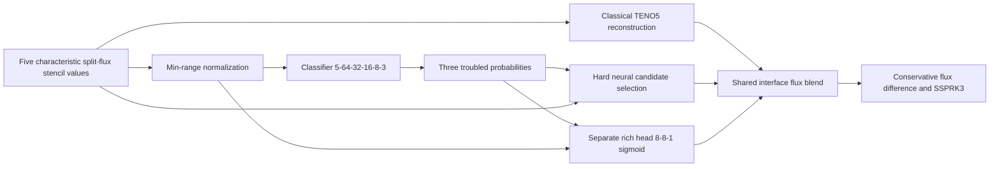

# Research interview summary

## A. Research evolution

**TENO5 → NENO6 inspiration → NN-TENO5 → NN-TENO5-V2 with a learned mixing head.**

TENO5 applies deterministic smoothness-based candidate selection. Li, Fu and
Adams' NENO6 demonstrates learned stencil selection with six inputs and four
candidate decisions. Our NN-TENO5 uses five inputs and three decisions, with
TENO5 candidate polynomials and a separately trained original classifier. V2
adds an independently parameterized learned coefficient blending classical and
neural reconstructions. Its backbone was also fine-tuned, so a main-model
comparison alone cannot identify the head's causal contribution.

## B. Main measured findings

| Benchmark | N | Metric | TENO5 | NENO6 | NN-TENO5 | V2 learned head |
| --- | --- | --- | --- | --- | --- | --- |
| sod | 128 | density_l1 | 0.004452127 | 0.004234734 | 0.004434132 | 0.004455158 |
| sod | 128 | l1 | 0.006344701 | 0.006111865 | 0.006303808 | 0.006351273 |
| lax | 128 | l1 | 0.02632591 | 0.02636503 | 0.02597659 | 0.02578272 |
| shu_osher | 128 | l1 | 0.2304674 | 0.2097592 | 0.2280766 | 0.2270421 |
| shu_osher | 128 | regional_density_l1 | 0.3560382 | 0.3426656 | 0.3569309 | 0.3525779 |
| burgers_pre | 128 | l1 | 3.906289e-05 | 3.570585e-05 | 3.906289e-05 | 3.107954e-05 |
| burgers_post | 128 | l1 | 0.001818696 | 0.001478109 | 0.001682797 | 0.001825657 |
| burgers_hat | 128 | l1 | 0.006151853 | 0.005839439 | 0.006177979 | 0.005864129 |
| advection_square | 128 | l1 | 0.01865898 | 0.01302991 | 0.0188542 | 0.0176154 |
| advection_smooth | 256 | l1 | 7.599293e-10 | 3.915144e-07 | 7.599293e-10 | 1.640334e-07 |

Evidence: **NEW MATCHED EVALUATION**, full precision in CSV/JSON.
Among the declared main exact-reference problems/grids, the largest original-NN
L1 improvement is +7.472% on burgers_post N=128; its worst is -1.046%
on advection_square N=128. The largest V2-vs-original-NN difference on those cases
is +20.437% on burgers_pre N=128. These are extrema of this exposed suite,
not estimates of generalization. Inspect the same-backbone learned-vs-fixed
column below before crediting adaptivity rather than simply weak mixing.

| N=128 case | Pure same backbone | Fixed same backbone | Learned same backbone | Learned vs pure | Learned vs fixed |
| --- | --- | --- | --- | --- | --- |
| sod | FAILED | 0.006350602 | 0.006351273 | N/A | -0.011% |
| lax | FAILED | 0.02578176 | 0.02578272 | N/A | -0.004% |
| shu_osher | FAILED | 0.2269573 | 0.2270421 | N/A | -0.037% |
| burgers_pre | 0.0001787713 | 3.363061e-05 | 3.107954e-05 | +82.615% | +7.586% |
| burgers_post | 0.01241355 | 0.001817578 | 0.001825657 | +85.293% | -0.445% |
| burgers_hat | 0.2157578 | 0.005946483 | 0.005864129 | +97.282% | +1.385% |
| advection_square | 2.337324e+07 | 0.01781522 | 0.0176154 | +100.000% | +1.122% |

| Method | All completed | Stress completed | Max budget residual | Raw min rho incl failures | Raw min p incl failures |
| --- | --- | --- | --- | --- | --- |
| TENO5 | 25/27 | 8/10 | 1.08451e-11 | 8.819782e-06 | -0.03464694 |
| NENO6 | 23/27 | 6/10 | 1.338663e-11 | 8.445584e-06 | -0.003348447 |
| NN-TENO5 | 21/27 | 4/10 | 9.265477e-12 | 8.82176e-06 | -0.03080745 |
| NN-TENO5-V2 (Learned Mixing Head) | 21/27 | 4/10 | 9.691803e-12 | -0.001017636 | -0.00341922 |

Runtime overhead is case-specific; see `RESULTS.md` for repeated median/IQR
and compilation costs. No universal speedup or positivity guarantee is supported.
Shu small gains require the numerical-reference sensitivity qualification.

At Sod N=128, warmed CPU medians in seconds are
TENO5=0.0564643,
NENO6=0.126493,
original NN=0.0903858, and
learned-head V2=0.154249.
The strongest same-grid exact-reference improvement among these saved methods
is NENO6's +35.102% on
advection_square N=256.
This is a measured error reduction, not a universal efficiency advantage.

## C. Slide-ready material

Use the table above, keeping N/time/metric and evidence labels visible.
Three profile plots: `figures/01_sod_density_comparison.png`,
`figures/03_shu_osher_density_zoom.png`, and `figures/04_burgers_comparison.png`.
Use the lambda plot and same-backbone table to explain what the head adds.
If discussing Lax, use `figures/02_lax_density_comparison.png`.

Architecture diagram specification:

The rich head has81 parameters; the backbone has3155. Scalar run6 instead has
a3→1 head with4 parameters. Neither consumes the full proposed PDF feature vector.
For Euler, the same head is reused per characteristic field and per split-flux
direction, then projected to one conservative face flux; interface lambda plots
show the mean/range of those six scalar outputs.

Three conclusions: (1) verified saved methods yield case-dependent gains and
regressions; (2) fixed/learned mixing can temper an unstable backbone, while the
increment over a fixed blend must be measured separately; (3) conservation,
admissibility, accuracy and runtime are distinct measured properties.

Three limitations/open questions: (1) historical validation exposure and single
saved training seeds limit generalization claims; (2) raw strong-shock failures
and nonlinear solver consistency remain unresolved; (3) reference uncertainty
and neural runtime costs can outweigh small apparent gains. The expanded physics
vector is future work, not a feature of these measured checkpoints.

## D. Defensible oral explanations

**Why neural selection?** Deterministic thresholds are fixed; learned local
selection might better balance dissipation and resolution. Our tests decide
whether that benefit is realized; classification accuracy alone does not.

**What does NENO6 contribute?** The published six-point/four-candidate learned
selection design motivated this line of work. We located its authentic author
weights and verified reconstruction parity. Our Euler/Burgers results are matched
ports, not the publication's complete solver reproductions.

**How is NN-TENO5 different?** It has five values, three TENO5 candidates and
different training/normalization/weights. It is not NENO6 with another name.

**Why a separate head?** Probabilities describe candidate trouble; they need not
be a useful direct neural-intervention coefficient. A separate parameterized
head can learn that blending decision. Its actual benefit is the learned-vs-fixed
same-backbone measurement, not the size of its network.

**Does blending guarantee positivity?** No. A convex blend of reconstructed
fluxes alone does not prove density/pressure positivity of RK stage states.
We measure raw stages and retain failures without repairs.

**Reconstruction or solver improvement?** The underlying historical formulation
is held fixed in this package. The experimental finite-volume state-flux solver
is a different research contribution and its gains are not credited here.

**Consistent across PDEs?** Only the case-specific tables support conclusions.
Both favorable and unfavorable cases are shown; no universal improvement is
claimed. Scalar and Euler heads are different saved specializations.

**How expensive?** All methods run in one JAX CPU implementation. Compilation
is separated from three repeated synchronized warmed rollouts; the measured
median/IQR and cross-grid cost comparison are reported. No GPU speed claim follows.

## E. Essential negative findings to present

The scalar3→1 head improves pre-shock Burgers N=128 by
+7.586% over the same-backbone fixed blend.
The richer Euler head does not beat that fixed-blend control on Sod/Lax/Shu at
N=128 and its lambda is nearly constant. Scalar V2's smooth N=256 error ratio is
215.854 relative to TENO5, with observed order about3 rather than5.
The pure scalar head backbone's finite advection blow-up is retained, and all
three neural methods fail the wall-aligned blast controls. NENO6 instead handles
the strong-contrast cases that defeat the other three. These outcomes support
case-specific investigation, not an unqualified upgrade claim.

The NENO6 paper's optimized background constraint is fourth order; six denotes
stencil width. Full neural convergence can degrade and is measured in Figure06.
Small Shu differences remain reference-sensitive. Use TENO5 as the general
research baseline while investigating which learned corrections are useful.
